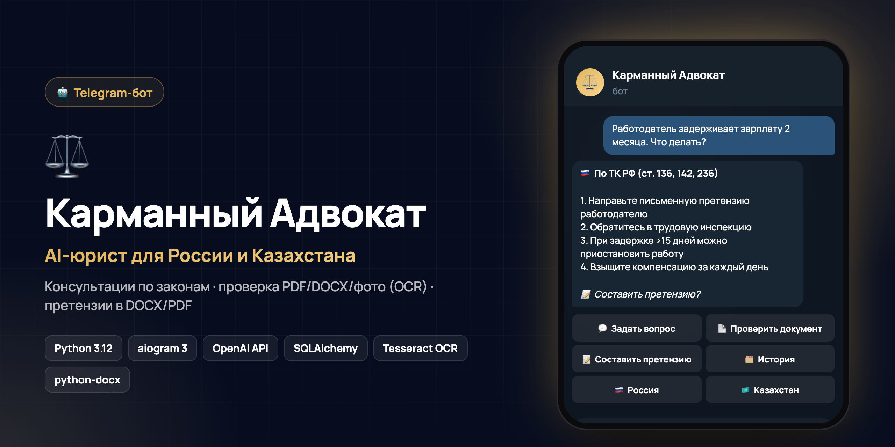

<div align="center">



# Карманный Адвокат

**Telegram-бот: AI-юрист для России и Казахстана**

     

*🇬🇧 AI legal assistant bot for Russia and Kazakhstan — answers by local law, checks PDF/DOCX/photos with OCR, drafts claims as DOCX/PDF, admin panel.*

</div>

---

Telegram-бот на Python 3.12 и Aiogram 3.x: юридический AI-помощник для России и Казахстана.

Бот помогает задать правовой вопрос, проверить документ, найти риски, подготовить черновик текста или документа и сохранить историю обращений. Ответы носят информационный характер и не заменяют консультацию адвоката или юриста.

## Возможности

- премиальный стартовый экран с картинкой;
- выбор юрисдикции: Россия или Казахстан;
- ответы по законам выбранной страны;
- профиль пользователя и смена страны;
- консультации через OpenAI API или совместимый API;
- проверка PDF, DOCX и фотографий документов;
- OCR через Tesseract;
- генерация претензий в DOCX/PDF;
- история запросов в SQLite;
- админ-панель со статистикой, логами ошибок и рассылкой.

## Структура

```text
app/
  handlers/      Telegram-обработчики
  services/      бизнес-логика, LLM, страны и профиль бота
  database/      подключение и репозитории
  models/        SQLAlchemy-модели
  ocr/           OCR и извлечение текста
  documents/     генерация DOCX/PDF
  prompts/       системные и пользовательские промпты
  templates/     шаблонные настройки документов
  utils/         общие утилиты
assets/          картинка стартового экрана
main.py          точка запуска
```

## Telegram Token

1. Откройте Telegram и найдите `@BotFather`.
2. Отправьте `/newbot`.
3. Укажите название и username бота.
4. Скопируйте token.
5. Запишите его в `.env` как `BOT_TOKEN`.

Если token был опубликован, лучше перевыпустить его через BotFather командой `/revoke`.

## OpenAI API Key

Для OpenAI:

1. Откройте [platform.openai.com](https://platform.openai.com/).
2. Создайте API key.
3. Укажите ключ в `.env` как `OPENAI_API_KEY`.

Для совместимого API заполните также:

```env
OPENAI_BASE_URL=https://api.openai.com/v1
OPENAI_MODEL=gpt-4o-mini
```

Если `OPENAI_API_KEY` не заполнен, бот запустится, но юридические AI-ответы будут просить добавить ключ.

## Стартовая Картинка

Скопируйте превью в проект:

```bash
mkdir -p assets
cp "/путь/к/картинке.png" assets/start_preview.png
```

В `.env` укажите путь:

```env
START_PREVIEW_IMAGE=assets/start_preview.png
```

Можно указать полный путь:

```env
START_PREVIEW_IMAGE=/полный/путь/к/project/assets/start_preview.png
```

Если файл не найден, бот не упадет и отправит только текстовое приветствие.

## Установка

```bash
python3.12 -m venv .venv
source .venv/bin/activate
pip install --upgrade pip
pip install -r requirements.txt
cp .env.example .env
```

Минимальный `.env`:

```env
BOT_TOKEN=ваш_telegram_token
OPENAI_API_KEY=
OPENAI_BASE_URL=https://api.openai.com/v1
OPENAI_MODEL=gpt-4o-mini
START_PREVIEW_IMAGE=assets/start_preview.png
DEFAULT_COUNTRY=
ENABLE_BOT_PROFILE_SETUP=true
ADMIN_IDS=
```

`DEFAULT_COUNTRY` можно оставить пустым. Тогда новый пользователь должен выбрать страну при `/start`.

## Tesseract OCR

macOS:

```bash
brew install tesseract
brew install tesseract-lang
```

Если Tesseract установлен нестандартно:

```env
TESSERACT_CMD=/opt/homebrew/bin/tesseract
```

Ubuntu/Debian:

```bash
sudo apt update
sudo apt install tesseract-ocr tesseract-ocr-rus tesseract-ocr-eng
```

Windows:

1. Установите Tesseract OCR.
2. Установите русский и английский языковые пакеты.
3. Укажите путь в `.env`, например:

```env
TESSERACT_CMD=C:\Program Files\Tesseract-OCR\tesseract.exe
```

## Запуск

```bash
source .venv/bin/activate
python main.py
```

SQLite-база создается автоматически в `data/bot.db`.

При запуске бот попробует установить профиль в Telegram:

- имя;
- короткое описание;
- полное описание;
- команды `/start`, `/menu`, `/profile`, `/country`, `/about`, `/privacy`, `/delete_data`, `/help`.

Если Telegram API не позволит обновить профиль, ошибка попадет в лог, но бот продолжит запуск.

## Проверка В Telegram

1. Отправьте `/start`.
2. Новый пользователь должен увидеть картинку и выбор страны.
3. Выберите `🇰🇿 Казахстан`.
4. Нажмите `⚖️ Консультация` и задайте вопрос.
5. Ответ должен идти по законодательству Республики Казахстан.
6. Отправьте `/country`.
7. Выберите `🇷🇺 Россия`.
8. Следующий ответ должен идти по законодательству Российской Федерации.

Проверьте команды:

```text
/start
/menu
/profile
/country
/about
/privacy
/delete_data
/help
```

## Админ-Панель

Команда:

```text
/admin
```

Доступна только пользователям из `ADMIN_IDS`.

## Продакшен

Для постоянной работы используйте `systemd`, Docker или process manager. Логи пишутся в `data/logs/bot.log`.
